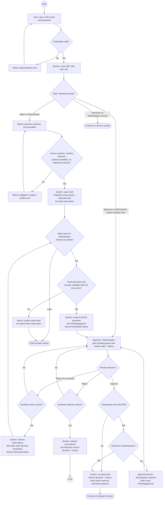
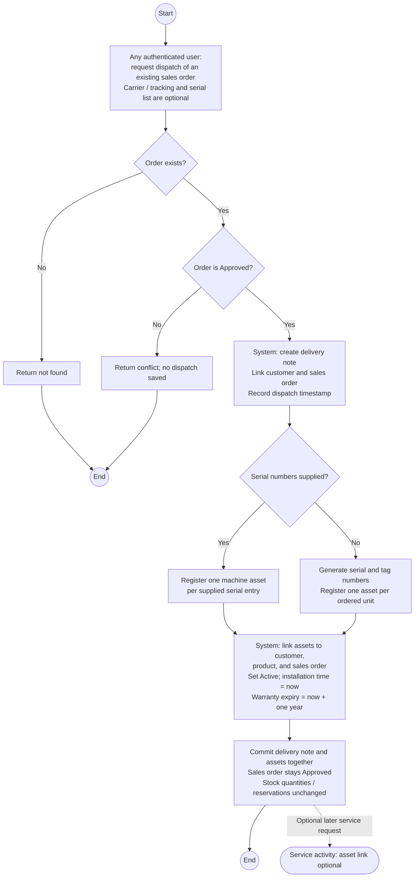
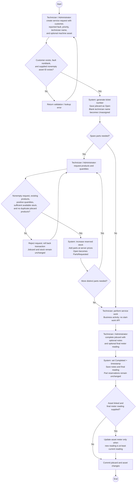

# ERPFlow — implemented business activity diagram

Reviewed: 2026-10-24. Scope: current backend implementation, including sales, equipment delivery, and service operations. Three linked activity views keep decisions readable. These describe executable API workflows, not a proposed future process.

## 1. Sales order and approval

**Guards:** Submit requires Draft; approve, reject, and return require PendingApproval. Sales can access only their own orders. Administrator can create/submit and review orders, including their own; no separation-of-duties rule exists. The $10,000 threshold applies to approval, not rejection or return. Exactly $10,000 may be approved by an Approver.

**Returned orders:** The API returns them to Draft and allows resubmission, but exposes no item/customer edit endpoint. The loop above therefore means resubmission of the saved draft, not an implemented correction editor.

## 2. Dispatch and machine registration

**Implementation boundary:** Dispatch is authenticated-only, with no Sales/Administrator policy or ownership check. It does not mark an order Dispatched, consume stock, confirm delivery, or explicitly prevent repeat dispatch. Supplied serials are not checked against ordered product quantities. Persistence constraints may still reject conflicting identifiers.

## 3. Service jobcard and spare parts

**Implementation boundary:** Service creation does not require an active customer, an asset, or a prior order/dispatch. Asset/customer ownership matching is not checked. `InProgress` and `Cancelled` exist in the domain enum but have no API transition. Completion has no status guard; repeated completion and requesting parts after completion are not explicitly blocked. Parts requests increment reserved stock, but the returned `StockReservation` object is not added to persistence; completion neither consumes nor releases that stock. Duplicate-part domain failures currently become generic 500 responses rather than mapped workflow conflicts.

## Shared rules and consistency

- `AvailableStock = StockOnHand - ReservedQuantity`. Sales submission reserves; rejection and return release; approval keeps reservations. Dispatch and service completion do not reduce StockOnHand.
- Each mutation shown is saved in a database transaction. Sales order/product row versions protect against concurrent updates; conflicts roll back rather than partially applying stock changes.
- JWT authentication protects all operations except login. Missing/invalid authentication returns 401; policy denial returns 403. Service writes require Technician or Administrator. Reference, equipment, and service reads require authentication.
- Missing resources return 404; mapped validation errors return 400; mapped workflow/concurrency conflicts return 409. Unmapped exceptions return generic 500. Error branches preserve prior persisted state.
- Sales history records Submitted, Approved, Rejected, and Returned. There is no global history-feed endpoint.

## Contract drift found

The current route file and OpenAPI contract contain **21 operations**, not the 11 stated in AGENTS.md / the original frontend handoff. Current code includes Technician, return-for-correction, equipment/delivery, service jobcards, and the Administrator approval threshold. These diagrams follow current routes and implementation.

## Source map

| Behavior | Authoritative source |
| --- | --- |
| Routes and endpoint policies | `ERPFlow.Api/ApiEndpoints.cs`, `ERPFlow.Api/Program.cs` |
| Sales roles, ownership, validation, threshold, transactions | `ERPFlow.Application/SalesOrders/SalesOrderWorkflow.cs` |
| Sales transitions, reservation release, price snapshot | `ERPFlow.Domain/Entities/SalesOrder.cs`, `SalesOrderItem.cs` |
| Available stock and reservation accounting | `ERPFlow.Domain/Entities/Product.cs`, `StockReservation.cs` |
| Dispatch and automatic asset registration | `ERPFlow.Application/Equipment/EquipmentWorkflow.cs`, `ERPFlow.Domain/Entities/MachineAsset.cs` |
| Service request, parts, completion, meter updates | `ERPFlow.Application/Service/ServiceWorkflow.cs`, `ERPFlow.Domain/Entities/Jobcard.cs` |
| Persistence and transactional boundaries | `ERPFlow.Infrastructure/Persistence/EfSalesOrderPersistence.cs`, `EfEquipmentPersistence.cs`, `EfServicePersistence.cs` |
| Error response mapping | `ERPFlow.Api/ApiExceptionHandler.cs` |
| Wire contract | `docs/openapi/erpflow-v1.json` |
